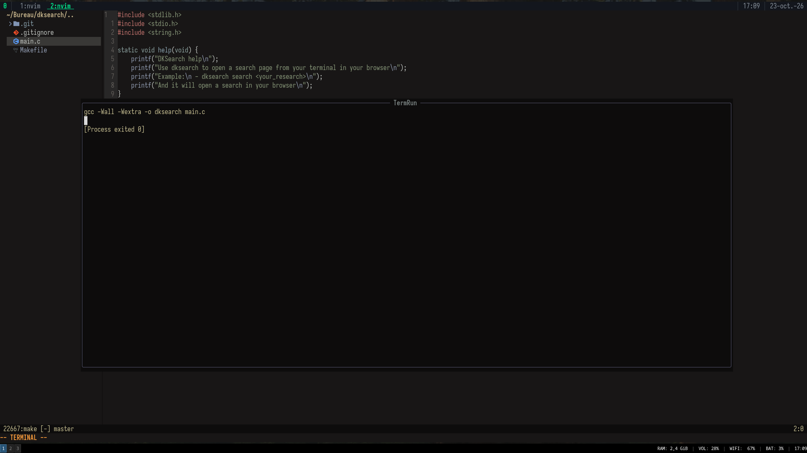

# termrun.nvim

termrun.nvim is a neovim plugin that allows developers to run some compilation command they can configure manually in a floating terminal

## Example

<p align="center">
  
</p>

## Installation

Create a file named `termrun.lua` in your plugins directory and write this:

```
return {
    "dkdwn/termrun.nvim",
    main = "termrun",
    lazy = false,
    opts = {
        commands = {
            c = "make",
            python = "python3 %f",
            rust = "cargo run",
            ruby = "ruby %f",
        },
    },
}
```

You can see for example `c = "make"`, you can change it as you want, same for others languages.

## Start

In a file with a configured filetype run `:Compile`, it will open the floating terminal with the compilation.

## Thanks

Thanks to all contributor and users • Made with passion by [@DankDown10256](https://github.com/DankDown10256)
